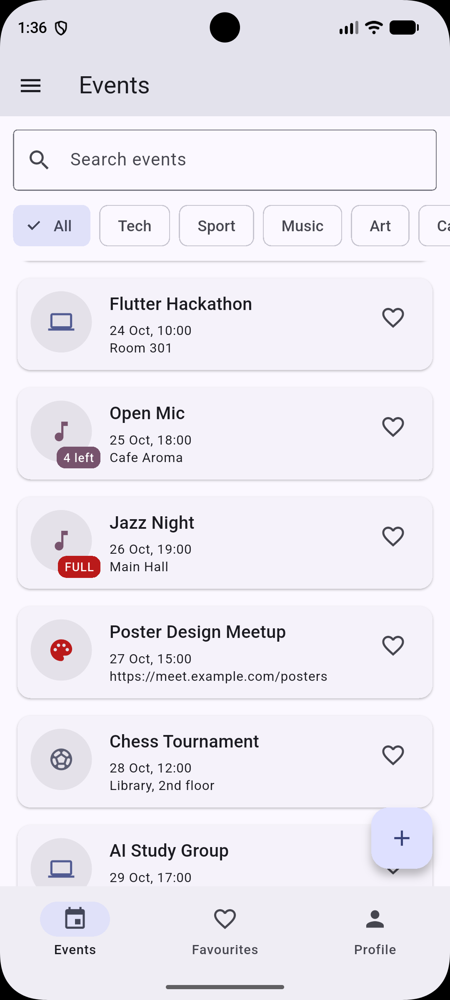
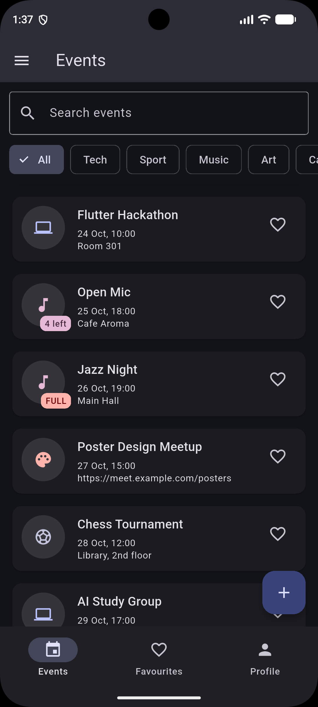

# Campus Events

A small multi-screen Flutter app for campus events. Each event has a title,
a category, a start time, a place (or a link when the event is online), a
limit of places and a list of people who registered. "Register" adds your
name from the profile. Everything lives in memory: no network, no storage.

Screens: a list (search, category chips, past filter, list on phones and grid
on tablets), a detail screen (countdown, About / Names tabs, register button),
a form for new and edited events, favourites, a profile with the theme
switch, and a drawer with About and Reset data.

## Screenshots

| Phone, light | Phone, dark | Tablet, grid |
| --- | --- | --- |
|  |  |  |

## Decisions

The list of events and the profile live in the State of the shell, because
three tabs and two pushed screens need the same data and only one widget
should be allowed to change it. The detail screen receives the item and
callbacks through its route arguments, so it can change the data without
knowing who owns it, while the form returns a new Item through pop, so the
caller decides what to do with it and backing out changes nothing. The list
uses a LayoutBuilder because the question is how wide this widget is, not how
wide the whole screen is, and it switches to a grid at 600 px. PopScope
compares a snapshot of all form values now with the snapshot taken when the
form opened, so a clean form closes silently and a dirty one asks first.
With week 9's tools I would move the data out of the shell into a proper state
holder, so tabs and pushed screens could read it directly instead of passing
it down.

